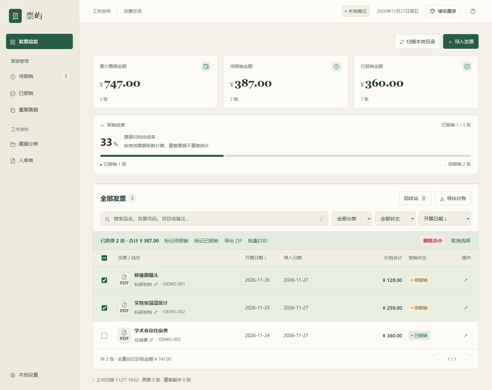

# 票屿 Piaoyu

我用 vibe coding 做了票屿，平时用它整理浙江大学科研材料入库和日常报销的票据。

把发票 PDF、图片或 ZIP 拖进来，就能查重复、核对金额，顺手记下哪些已经报销。选中科研材料的 PDF 发票，还能按浙大的表样生成 Word 入库单和配套统计表。票据和台账都留在自己的电脑上，装好后可以离线用。

## 开始使用

1. 在 Windows 10/11 上安装 Python 3.10 或以上版本，勾选 **Add Python to PATH**。
2. [下载 ZIP](https://github.com/Rainluoer/piaoyu-invoice-workbench/archive/refs/heads/main.zip) 并解压，首次使用双击 **安装依赖.cmd**。
3. 双击 **启动工作台.cmd**。浏览器打开后，可以直接拖入发票，也可以在「本地设置」里指定发票文件夹。

[使用说明](docs/USAGE.md) · [更新记录](docs/CHANGELOG.md) · [贡献指南](CONTRIBUTING.md)

项目采用 [MIT 许可](LICENSE)。入库单处理使用了 [Ruku](https://github.com/3450530868/Ruku) 的脚本。[第三方说明](THIRD_PARTY_NOTICES.md)
